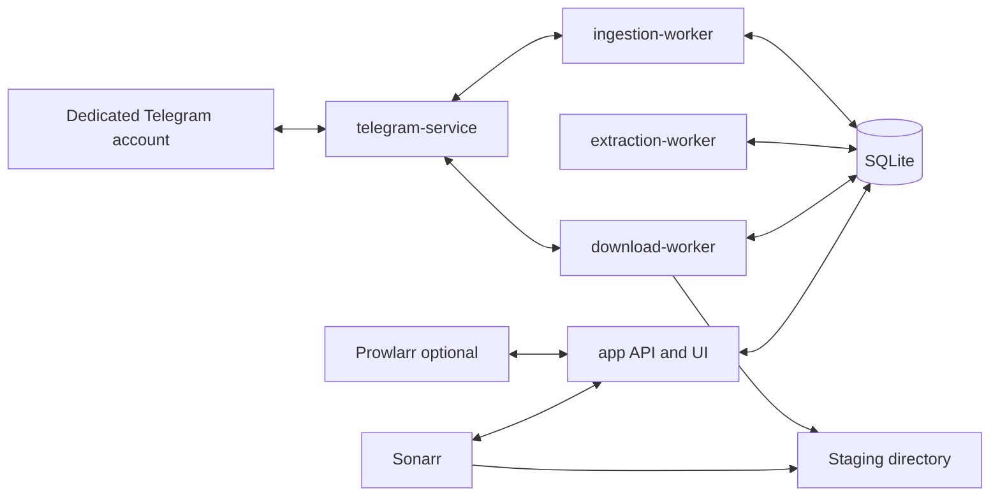
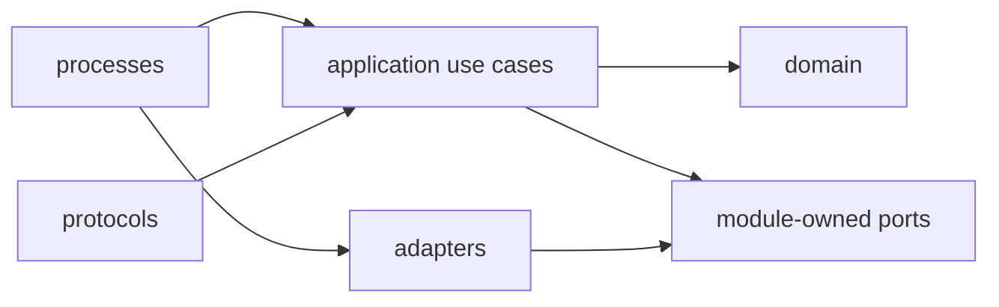
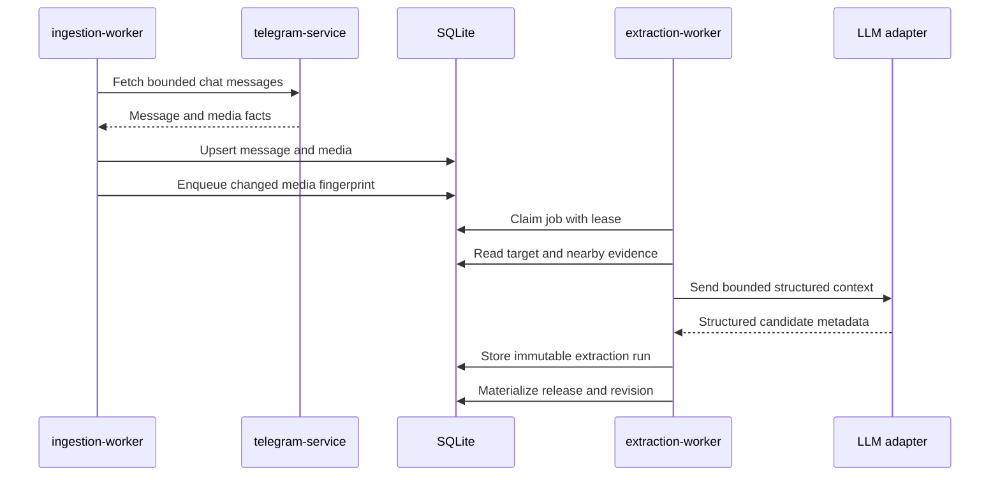
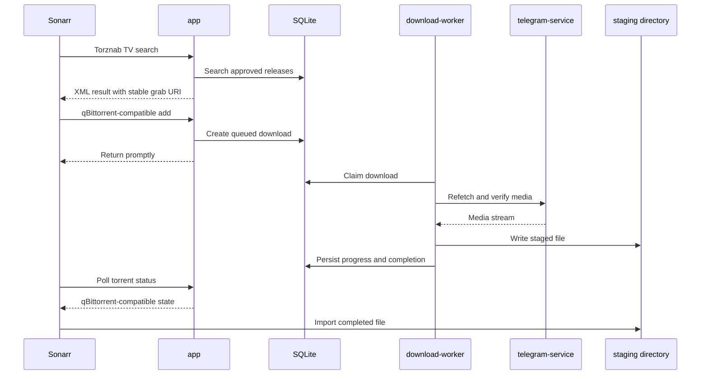
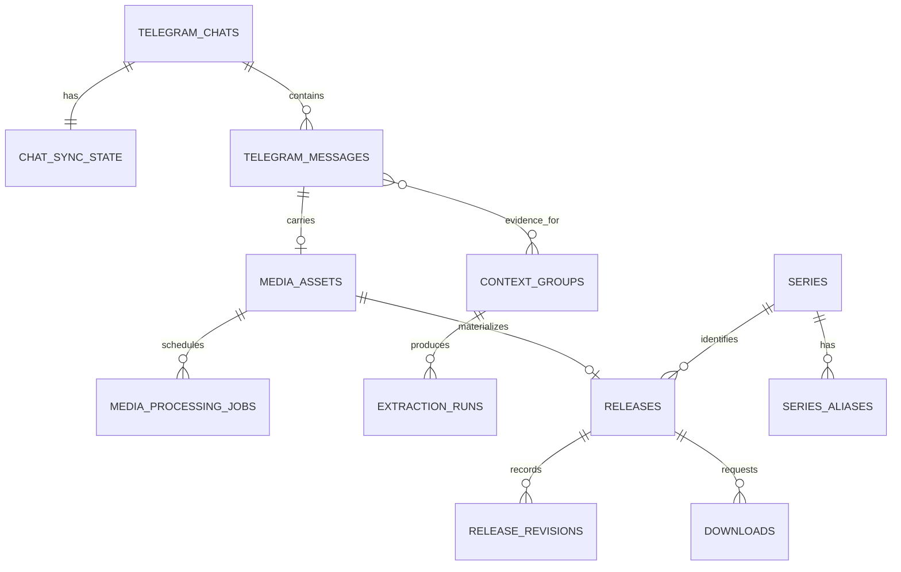

# Architecture

This document describes the current pre-alpha implementation. Future changes belong in the [roadmap](../ROADMAP.md) until they are built.

TeleSift is a TypeScript modular monolith with multiple process entrypoints, one SQLite database, one container image, and a React operator UI. Process separation isolates long-running work; it does not create independently versioned services.

The project was informed by [MuLarr](https://github.com/joecarl/mularr), an MIT-licensed TypeScript application that demonstrated Telegram user authentication, SQLite indexing, Torznab, and a qBittorrent-compatible facade. TeleSift is a separate Telegram-focused codebase; compatible ideas or code may be reused only with required attribution.

## System boundary



Only `telegram-service` talks to Telegram. Other roles use its bounded internal HTTP contract. The application exposes the operator UI, application API, Torznab endpoint, and qBittorrent-compatible API. Sonarr imports completed files from staging into its own library.

## Runtime roles

All long-running roles are built from the same source and image:

- `app` serves the authenticated UI and application APIs. It handles interactive commands, Torznab search, and qBittorrent-compatible requests. It enqueues work instead of performing backfills, extraction, or downloads inline.
- `telegram-service` owns the sole live MTProto client and reusable Telegram session. It reports connection state, lists chats/messages, refetches messages, and streams media through an internal-only API.
- `ingestion-worker` resolves configured channels, backfills history, polls for new messages, stores source data, and schedules media processing.
- `extraction-worker` builds context, runs deterministic parsing and the selected LLM adapter, validates output, resolves series, and materializes releases.
- `download-worker` reconciles requested download state, verifies Telegram availability, transfers media to staging, and records progress and failures.

Short-lived entrypoints:

- `migrate` applies ordered SQLite migrations before other roles start.
- `manage-channels` provides a development/operator command for monitored channels.

The reference Compose deployment runs one instance of every long-running role on one host. Worker and Telegram singleton locks use heartbeat files. SQLite and the staging directory are shared filesystem resources.

## Code boundaries

```text
src/
  processes/   composition roots and process loops
  modules/     domain rules, use cases, and required ports
  protocols/   HTTP/XML request and response translation
  adapters/    SQLite, Telegram, LLM, and filesystem implementations
  platform/    configuration, logging, time, locks, and lifecycle
```

Dependency direction:



Domain code has no infrastructure imports.

Rules enforced by this shape:

- Domain code does not import HTTP, SQLite, Telegram, filesystem, or LLM SDKs.
- Application use cases own workflows and transaction boundaries.
- The module that needs a capability defines its port; an adapter implements it.
- Process entrypoints load role-specific configuration, compose dependencies, start loops or servers, and handle shutdown. They do not own business rules.
- Protocol handlers translate external contracts and call application use cases. Torznab and qBittorrent handlers do not decide catalog or download behavior.
- Cross-process work is handed off through durable SQLite rows, not process memory or an event bus.
- External Telegram transfers and LLM requests run outside SQLite write transactions.

Current modules are `app-auth`, `telegram-access`, `ingestion`, `context`, `extraction`, `catalog`, `search`, `review`, and `downloads`.

## Ingestion and extraction flow



Messages use `(chat_id, telegram_message_id)` as their source identity. An input fingerprint prevents unchanged overlap scans from producing duplicate effects. Per-chat state records the newest incrementally seen message, oldest backfilled message, backfill completion, recent scan time, and last error.

Each current media asset has one context group. A group contains the target plus candidate evidence labelled `preceding`, `reply`, or `album_sibling`. The current builder does not yet model every planned signal described by the product rules.

Media-processing jobs are transactionally claimed with a short lease. The worker commits the claim before external work, records attempts/errors, and allows an expired claim to be retried. Extraction runs are immutable and versioned by input, pipeline, prompt, and model.

Materialization keeps automatic extraction separate from the current canonical release. Manual review changes the release and appends a release revision. Only approved releases are returned by search.

## Grab and download flow



The app changes a download's desired state; only the download worker changes observed state and transfer progress. Multiple attempts may exist for one release. A stable client hash lets Sonarr poll the latest attempt.

## Persistence model



Logical ownership:

- Ingestion owns configured channels, resolved Telegram chats, sync state, messages, and media assets.
- Context/extraction owns processing jobs, context groups and membership, and extraction runs.
- Catalog owns series, aliases, releases, revisions, and release search.
- Downloads owns requests, desired/observed state, leases, progress, staging paths, and errors.
- App routes invoke module use cases rather than writing another module's tables directly.

The schema is migration-driven through Kysely and `better-sqlite3`. SQLite runs in WAL mode. The design assumes one host and one instance of each worker; a client/server database is deferred until measured load or multi-host deployment requires it.

## Protocols

- `telegram-internal` is deployment-private. It exposes connection status, chat/message reads, refetch, and media streaming rather than ingestion or download workflows.
- Torznab advertises `search` and `tvsearch`, accepting title/query, season, episode, paging, and an optional API key.
- The qBittorrent-compatible subset implements the calls Sonarr currently needs for login, version/preferences, categories, add, list/status, file properties, pause/resume, and delete.
- `app-api` serves authenticated operator actions and read models for the React UI.

These are compatibility surfaces, not complete implementations of Telegram, Torznab, or qBittorrent.

## Security boundaries and known gaps

- The Telegram session, API ID, and API hash are operator-provisioned environment variables. `telegram-service` is the only code that reads them and the only role that creates a Telegram client.
- The reference Compose file currently supplies the shared `.env` to every service. Although other processes do not read Telegram credentials, container-level secret delivery does not yet match the intended boundary.
- `telegram-service` has no published host port in the reference Compose deployment, but its HTTP contract has no independent authentication.
- The operator UI uses one configured administrator account and server-side sessions.
- Torznab API-key enforcement is optional.
- The qBittorrent-compatible login endpoint currently always succeeds so Sonarr integration can operate; it must not be treated as an authentication boundary.
- Logs and public artifacts must not include credentials, real message text, private identifiers, media filenames, or personal deployment data.

The pre-alpha deployment belongs on a trusted private network and should not be exposed directly to the internet.
